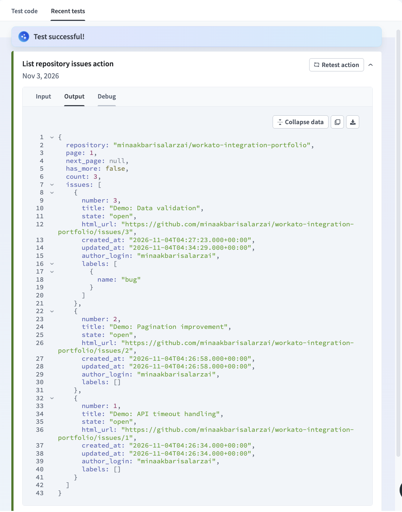
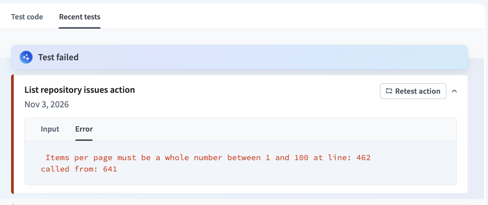

# Workato Integration Engineering Portfolio

**Automation · Custom Connectors · API Integrations · Workflow Design**

A collection of independently developed integration engineering projects demonstrating practical experience with **Workato, Ruby, Python, REST APIs, and automation architecture**.

This portfolio focuses on building maintainable integrations, designing reliable workflows, handling API failures, and validating implementations through testing.

**Author:** Mina Akbari  
**Specialization:** Workato Integrations | Custom Connector Development | API Automation

---

## Featured Project — GitHub Issue Explorer

**Status:** Implemented | Core functionality tested in Workato

**[View GitHub Issue Explorer — Source Code, Tests, Documentation & Screenshots](projects/03-custom-connector/)**

A custom Workato connector developed using **Ruby and the Workato Connector SDK**, integrating with the GitHub REST API to retrieve, filter, and process repository issues.

The project demonstrates a production-oriented approach to connector development, with emphasis on security, reusable code, configurable actions, structured responses, and descriptive error handling.

### Technical Highlights

- **Authentication:** Fine-grained GitHub personal access token authentication with connection validation.
- **Custom Connector SDK:** Ruby-based connector implementation with reusable helper methods and object definitions.
- **Dynamic Picklists:** Context-dependent repository and label selection.
- **API Integration:** GitHub REST API requests with configurable issue filters and sorting.
- **Pagination:** Link-header parsing with `next_page` and `has_more` metadata.
- **Input Validation:** Explicit validation of repository identifiers and pagination parameters.
- **Error Handling:** Descriptive messages for authentication, authorization, validation, rate limiting, and server failures.
- **Retry Configuration:** Bounded retries for supported transient HTTP errors.
- **Automated Testing:** Offline Ruby tests using synthetic API responses.

### Development and Testing

| Area | Evidence |
|---|---|
| Ruby syntax validation | Passed |
| Automated unit tests | 19 tests, 59 assertions passing |
| GitHub API authentication | Successfully tested in Workato |
| Repository issue retrieval | Successfully returned 3 demonstration issues |
| Pagination | First-page and final-page scenarios tested |
| Label filtering | Successfully filtered issues using the `bug` label |
| Input validation | Rejected invalid `per_page = 101` |
| API error handling | HTTP 422 error scenario exercised |

*Note: Some live Workato tests were performed on an earlier connector revision. The revised V2 implementation includes additional improvements that require further live verification.*

### Workato Demonstration

**Successful GitHub API integration**

The connector retrieves repository issues and returns structured data for downstream recipe actions.



**Custom input validation**

The connector rejects unsupported values and provides descriptive error messages to assist with troubleshooting.



**[Explore the complete connector project and all seven Workato screenshots](projects/03-custom-connector/)**

---

## Projects

| Project | Technical Focus | Status |
|---|---|---|
| [01 · Loop Control Patterns](projects/01-loop-control/) | Conditional iteration, control-flow behavior, and edge-case handling | Planned |
| [02 · Recipe Optimization](projects/02-recipe-optimization/) | Reducing unnecessary scripting with native Workato formulas | Planned |
| [03 · GitHub Issue Explorer — Custom Connector](projects/03-custom-connector/) | Ruby SDK, GitHub REST API, authentication, pagination, validation, and testing | **Implemented — Core Tested** |
| [04 · Embedded Integration Architecture](projects/04-embedded-integration/) | Reference architecture for workspace provisioning, secure embedding, and permissions | Planned |

Additional projects will be developed and documented incrementally.

See the [Project Roadmap](docs/ROADMAP.md) for planned work.

---

## Engineering Principles

My approach to integration engineering emphasizes practical solutions, maintainability, and predictable behavior.

**Correctness First**

Identify assumptions, validate inputs, document edge cases, and test expected behavior.

**Platform-Native Solutions**

Use Workato's built-in formulas, actions, and workflow capabilities where appropriate. Introduce custom code when it provides meaningful additional functionality.

**Reusable and Maintainable Code**

Keep logic modular, reduce duplication, and design integrations that are understandable to other developers.

**Resilience and Error Handling**

Consider API failures, authentication problems, permission issues, rate limits, pagination, and retry behavior.

**Security and Least Privilege**

Use restricted API permissions, avoid embedded credentials, and protect sensitive information.

**Testing and Documentation**

Include reproducible examples, technical explanations, validation scenarios, and clear implementation limitations.

---

## Technology Stack

| Category | Technologies |
|---|---|
| Integration and Automation | Workato, Workato Connector SDK |
| Programming Languages | Ruby, Python |
| APIs and Authentication | REST APIs, JSON, HTTP, Bearer Tokens |
| Development Practices | Input Validation, Error Handling, Pagination, Retry Logic |
| Testing | Ruby Minitest, Synthetic API Fixtures |
| Version Control | Git, GitHub |

---

## Repository Structure

```text
workato-integration-portfolio/
├── README.md
├── SECURITY.md
├── docs/
│   └── ROADMAP.md
└── projects/
    ├── 01-loop-control/
    ├── 02-recipe-optimization/
    ├── 03-custom-connector/
    │   ├── connector.rb
    │   ├── README.md
    │   ├── LICENSE
    │   ├── docs/
    │   │   ├── DESIGN.md
    │   │   └── TEST_PLAN.md
    │   ├── fixtures/
    │   │   └── issues_page.json
    │   ├── spec/
    │   │   └── connector_test.rb
    │   └── screenshots/
    │       ├── 01-connector-sdk.png
    │       ├── 02-recipe-configuration.png
    │       ├── 03-action-fields.png
    │       ├── 04-successful-api-response.png
    │       ├── 05-input-validation-error.png
    │       ├── 06-validation-test-input.png
    │       └── 07-successful-test-input.png
    └── 04-embedded-integration/
```

---

## How to Explore This Portfolio

Start with the **[GitHub Issue Explorer Custom Connector](projects/03-custom-connector/)**.

The project includes:

1. Ruby source code demonstrating the Workato Connector SDK.
2. Technical architecture and implementation decisions.
3. Automated tests and synthetic API fixtures.
4. Live Workato screenshots.
5. Input validation and error-handling examples.
6. Setup instructions, testing procedures, and known limitations.

The goal is to make each project understandable and reproducible without access to private systems or production environments.

---

## Confidentiality and Attribution

All examples are independently authored demonstrations developed for educational and portfolio purposes.

This repository does **not** contain employer or customer source code, proprietary integrations, production recipes, confidential configurations, authentication credentials, or customer information.

Demonstration projects use public APIs and synthetic data.

These projects are not affiliated with or endorsed by Workato, GitHub, or my employer.

---

## About Me

I am a software engineer specializing in **integration engineering, workflow automation, API integrations, and Workato custom connector development**.

My technical interests include designing reliable integrations, simplifying automation workflows, building reusable connectors, and improving the maintainability of integration systems.

Through this portfolio, I aim to demonstrate my engineering approach with practical, testable examples rather than relying solely on descriptions of previous work.

---

**Developed and maintained by Mina Akbari.**
