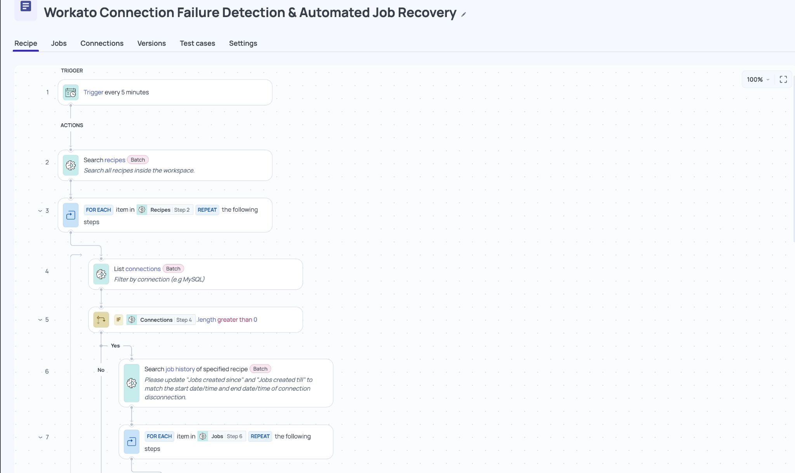
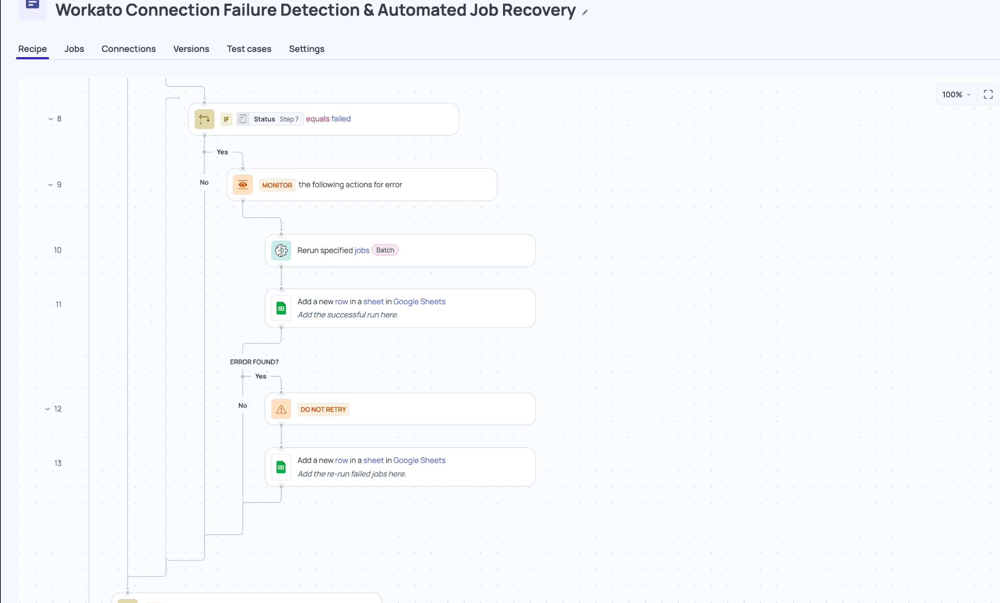
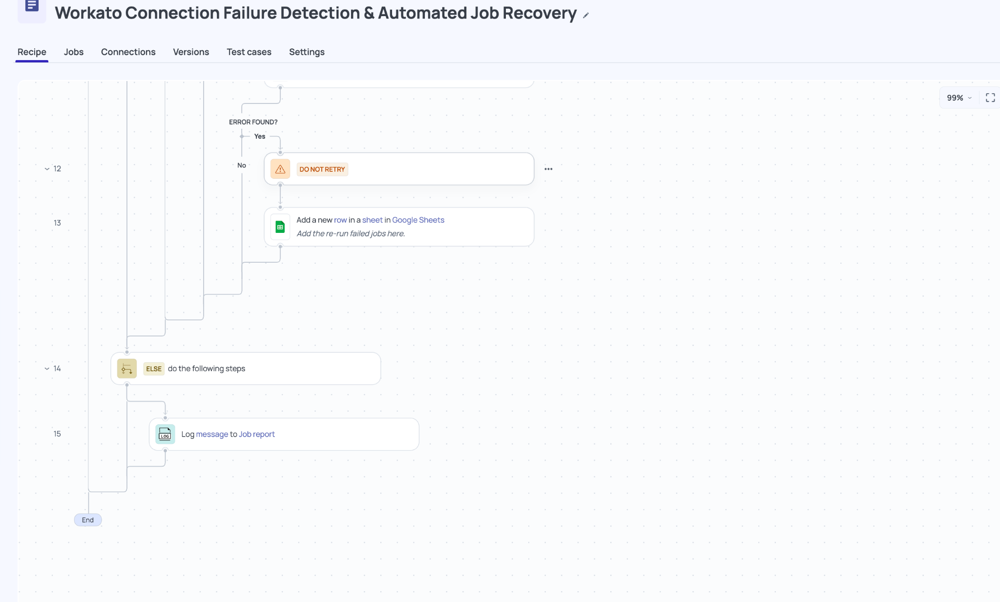

# Workato Connection Failure Detection & Automated Job Recovery

**Author:** Mina Akbari  
**Platform:** Workato  
**Focus:** Integration Reliability · Job Recovery · Workflow Automation

## Overview

This project demonstrates a Workato recipe designed to automate
the identification and recovery of integration jobs affected by
connection-related failures.

In addition to building integrations between applications,
integration engineers must ensure that existing integrations
remain reliable and recoverable when failures occur.

This workflow addresses that operational challenge using
Workato's built-in actions, conditional logic, batch processing,
error handling, and logging capabilities.

## The Problem — Why This Matters

Enterprise integrations depend on connections to external
systems, APIs, and services.

When a connection becomes unavailable, multiple Workato jobs
may fail during the outage. Even after connectivity is restored,
those failed jobs may still require manual intervention.

Without automation, an integration engineer may need to:

1. Identify recipes using the affected connection.
2. Search each recipe's execution history.
3. Locate jobs that failed during the disruption.
4. Rerun the affected jobs individually.
5. Track successful reruns and investigate recovery failures.

For environments with many recipes and failed executions,
this process can be repetitive, time-consuming, and
prone to human error.

The goal of this project is to reduce manual recovery work
by bringing these operations into a single Workato workflow.

---

## The Solution

I developed a Workato recipe that combines recipe discovery,
connection lookup, job-history inspection, failed-job
identification, batch reruns, and recovery logging.

The implementation uses Workato's native automation
capabilities rather than a separate monitoring application
or external recovery script.

### Workflow Process

**Step 1 — Scheduled Execution**

The recipe starts on a five-minute schedule to regularly
evaluate the configured recovery workflow.

**Step 2 — Recipe Discovery**

The recipe searches for available recipes within the
Workato workspace and iterates through the returned results.

**Step 3 — Connection Lookup**

For each recipe, the workflow retrieves connections using
the configured connector filter.

A conditional check determines whether matching connections
were found before proceeding.

**Step 4 — Job History Inspection**

The workflow retrieves job history for the selected recipe
within a specified time range.

The intended recovery window corresponds to the period
during which the connection disruption occurred.

**Step 5 — Failed-Job Identification**

The recipe iterates through the returned jobs and checks
whether each job has a `failed` status.

Jobs that do not meet the condition are excluded from
the rerun branch.

**Step 6 — Batch Job Recovery**

For jobs reaching the recovery branch, the workflow invokes
Workato's **Rerun specified jobs** action.

This provides a way to initiate recovery without manually
opening and repeating each failed execution.

**Step 7 — Recovery Logging**

The recipe uses Google Sheets actions to record recovery
activity, including successful rerun-action execution and
errors encountered during recovery.

**Step 8 — Error Handling**

A Workato Monitor block surrounds the rerun operation.

If an error occurs, the workflow follows a Do Not Retry
branch and logs the failure for further investigation.

---

## Workato Recipe Demonstration

The screenshots below show three consecutive sections
of the same Workato recipe.

### Section 1 — Recipe and Connection Discovery

This section demonstrates scheduled execution, recipe
discovery, connection lookup, conditional checks, and
job-history retrieval.



### Section 2 — Failed-Job Detection and Recovery

This section demonstrates failed-job evaluation,
the batch rerun action, and the monitored recovery
and logging flow.



### Section 3 — Error Handling and Completion

The final section demonstrates recovery-error logging,
the alternative processing branch, and workflow completion.



---

## Results and Operational Benefits

The completed recipe design brings several previously
manual recovery activities into one automated Workato workflow.

| Area | Result / Benefit |
|---|---|
| Recipe discovery | Centralized lookup of workspace recipes |
| Connection lookup | Filtered identification of connections |
| Job inspection | Automated retrieval of recipe execution history |
| Failure identification | Conditional selection of failed jobs |
| Job recovery | Batch rerun action integrated into the workflow |
| Error handling | Monitor and Do Not Retry paths |
| Audit visibility | Google Sheets logging of recovery activity |
| Maintainability | Native Workato actions without unnecessary Python steps |

### Key Outcome

The main result is a **consolidated recovery workflow**
that reduces the number of manual steps an integration
engineer would otherwise perform when investigating
and recovering failed jobs.

By automating recipe discovery, job inspection, and rerun
initiation, the workflow provides a more structured approach
to integration operations.

The screenshots establish the implemented recipe structure.
They do not independently establish a measured reduction
in recovery time or a successful end-to-end batch recovery
under real outage conditions.

---

## Engineering Considerations

Automated job recovery requires careful handling because
not every failed job is safe to rerun.

A production recovery process should account for:

- **Failure classification:** Confirm that failures are
  related to the affected connection rather than unrelated
  application or data errors.
- **Connection recovery:** Verify that the underlying
  connection is healthy before rerunning jobs.
- **Recovery window:** Restrict job searches to the
  relevant outage period.
- **Duplicate prevention:** Avoid replaying the same
  original job repeatedly.
- **Replay safety:** Consider whether completed steps
  could create duplicate business operations.
- **Auditability:** Record what was selected, rerun,
  and escalated for investigation.

These are important operational considerations.
Not all safeguards are demonstrated by the screenshots.

---

## Technical Capabilities Demonstrated

| Workato Capability | Application |
|---|---|
| Scheduled triggers | Periodic recovery workflow |
| Recipe search | Workspace recipe discovery |
| Connection search | Connector-based connection lookup |
| For Each loops | Iteration over recipes and jobs |
| Conditional logic | Connection and job-status checks |
| Job history search | Retrieval of execution records |
| Batch actions | Rerun specified jobs |
| Monitor blocks | Recovery action error handling |
| Do Not Retry | Controlled error-path behavior |
| Google Sheets connector | Recovery activity logging |

---

## Project Structure

```text
01-connection-failure-recovery/
├── README.md
└── screenshots/
    ├── 01-workflow-overview.png
    ├── 02-workflow-continuation.png
    └── 03-workflow-completion.png
```

---

## Key Takeaway

**Integration engineering is not only about connecting
systems. It is also about keeping those integrations
operational, reliable, and maintainable.**

This project demonstrates how Workato can be used to
automate internal integration operations, investigate
failed executions, and initiate recovery using existing
platform capabilities.

It highlights practical experience with Workato recipe
design, operational automation, batch processing,
conditional logic, error handling, and audit logging.

## Scope and Limitations

This repository documents the workflow through screenshots
and technical explanations. It does not provide an
executable Workato recipe export.

The workflow's visible `failed` status check does not,
by itself, prove that every selected failure was caused
by a connection outage.

Before production deployment, automated reruns should be
restricted to verified, recoverable failures with
appropriate replay-safety controls.

Any employer-owned workflow details or screenshots should
be shared publicly only with appropriate authorization.

---

**Developed and documented by Mina Akbari.**
