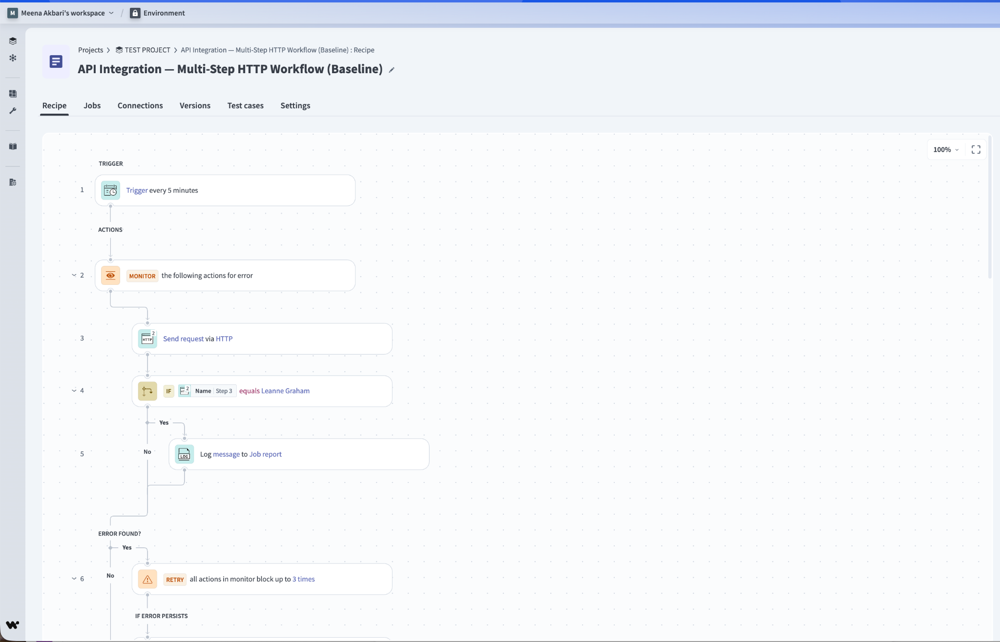
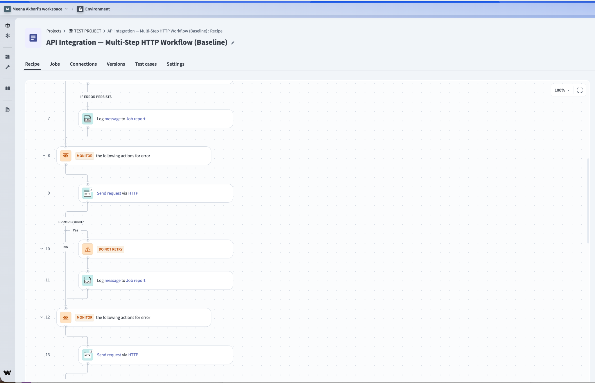
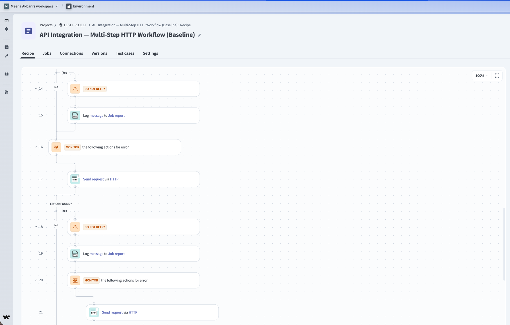
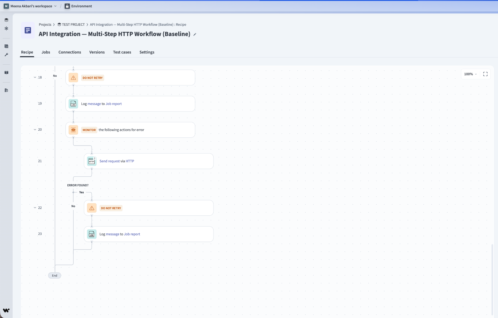
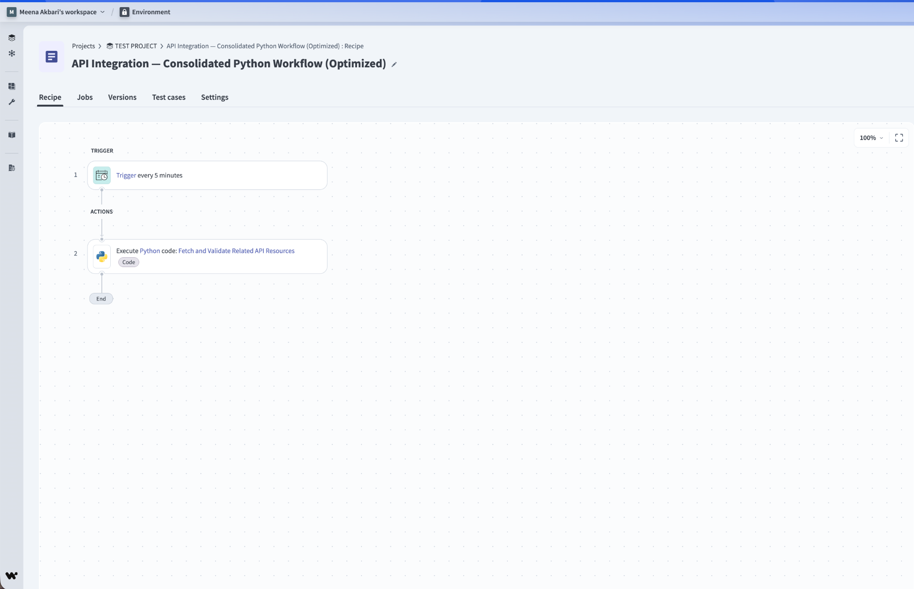
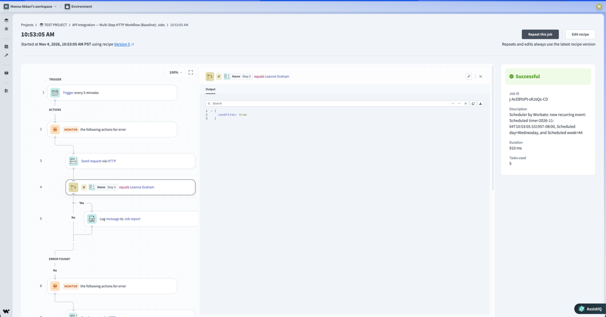
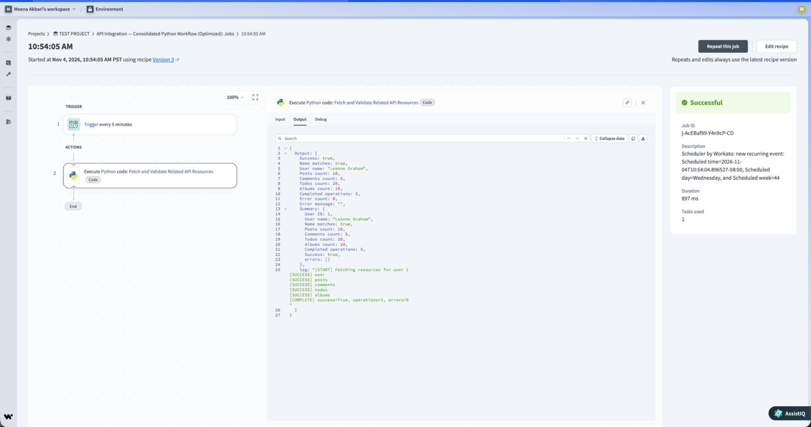

# Case Study 01 — Workato API Consolidation: HTTP vs Python

**Author:** Mina Akbari  
**Technologies:** Workato, Python, REST APIs, HTTP, JSON  
**Focus:** Task Optimization · Cost Efficiency · Maintainability

## Overview

This project demonstrates how consolidating repetitive HTTP actions into Python can reduce Workato task consumption and simplify integration workflows.

I compared two Workato recipes performing the same five REST API operations:

- **Baseline:** Separate HTTP connector actions with monitoring, conditional logic, and logging.
- **Optimized:** Consolidated Python implementation handling the API requests, validation, and error processing.

### Key Results

- **60% reduction in Workato tasks:** 5 → 2 per successful execution.
- **91.3% reduction in configured actions:** 23 → 2.
- Both workflows completed successfully.

## The Problem

The original recipe used five HTTP connector actions alongside monitoring, error handling, and logging.

Although functional, the workflow contained **23 configured actions** and consumed **5 Workato tasks** in the observed successful execution.

Complex recipes increase maintenance effort, while unnecessary task consumption can increase usage-based costs.

## The Solution

I consolidated the five API operations and their supporting request-handling logic into Python.

The optimized recipe performs the same five external GET requests while centralizing:

- HTTP requests and JSON response processing.
- Input validation and response verification.
- Retry handling for transient API failures.
- Structured outputs and error reporting.

### API Endpoints

**Public API:** [JSONPlaceholder](https://jsonplaceholder.typicode.com/)

| Operation | Endpoint |
|---|---|
| User | `GET /users/1` |
| Posts | `GET /posts?userId=1` |
| Comments | `GET /posts/1/comments` |
| Todos | `GET /users/1/todos` |
| Albums | `GET /users/1/albums` |

Both implementations perform five logical API requests. The optimization reduces Workato actions and tasks, not the number of external API operations.

## Results — November 4, 2026

| Measurement | Baseline HTTP | Optimized Python |
|---|---:|---:|
| Execution status | Successful | Successful |
| Configured actions | **23** | **2** |
| Actions eliminated | — | **21 (91.3%)** |
| Workato tasks consumed | **5** | **2** |
| Tasks eliminated | — | **3 (60%)** |
| Job duration | **910 ms** | **897 ms** |

### Business Impact

**Reduced Workato task consumption by 60%, lowering task-based resource usage and supporting cost efficiency in task-metered environments.**

At higher execution volumes, the savings accumulate:

| Monthly Executions | Original Tasks | Optimized Tasks | Tasks Saved |
|---|---:|---:|---:|
| 1,000 | 5,000 | 2,000 | **3,000** |
| 10,000 | 50,000 | 20,000 | **30,000** |
| 100,000 | 500,000 | 200,000 | **300,000** |

These are projections based on the observed task counts. Actual financial savings depend on the Workato billing agreement.

### Successful Execution

The optimized Python output reported:

| Validation | Result |
|---|---|
| `success` | `true` |
| `name_matches` | `true` |
| `completed_operations` | `5` |
| `error_count` | `0` |
| Posts retrieved | 10 |
| Comments retrieved | 5 |
| Todos retrieved | 20 |
| Albums retrieved | 10 |

All five intended API operations completed successfully in the optimized execution.

The baseline execution also succeeded, although complete endpoint-by-endpoint output equivalence has not been separately documented.

## Workato Implementation

### Baseline — Multi-step HTTP

The original recipe contains separate HTTP actions, monitoring blocks, conditional branches, and logging.

### Optimized — Consolidated Python

The optimized recipe uses Python to execute and validate the five API requests while reducing the configured workflow to two actions.

### Execution Evidence

**Baseline — 5 tasks, 910 ms**

**Optimized — 2 tasks, 897 ms**

The execution times represent one observed successful run of each design, not a statistically significant speed comparison.

## Source Code & Recipe Exports

- [Python Implementation](optimized.py) — Consolidated REST API requests, validation, and error handling.
- [Baseline Workato Recipe](recipes/baseline.recipe.json) — Original HTTP-based workflow.
- [Optimized Workato Recipe](recipes/optimized.recipe.json) — Python-based optimized workflow.
- [Benchmark Documentation](../docs/BENCHMARKS.md) — Measurement details.

Recipe exports are provided for reference and require environment-specific configuration before reuse.

## Key Takeaway

**Reduced Workato task consumption by 60% and configured workflow actions by 91.3%, while successfully executing the same five REST API operations.**

This demonstrates how thoughtful Workato recipe design can improve task efficiency, reduce unnecessary workflow complexity, and support lower usage-based costs.

---

**Developed and documented by Mina Akbari.**
