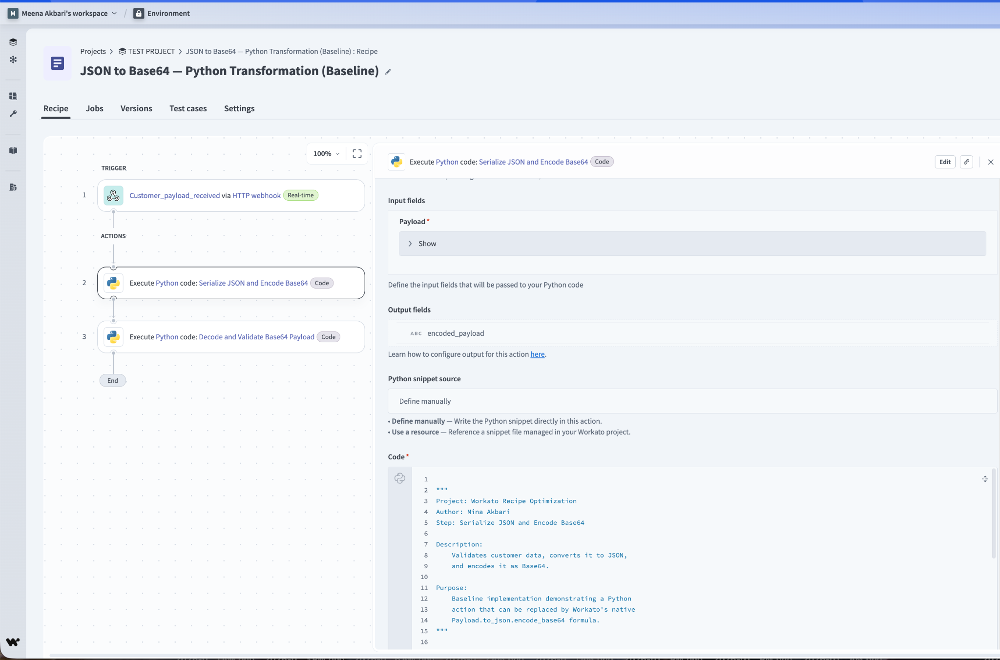
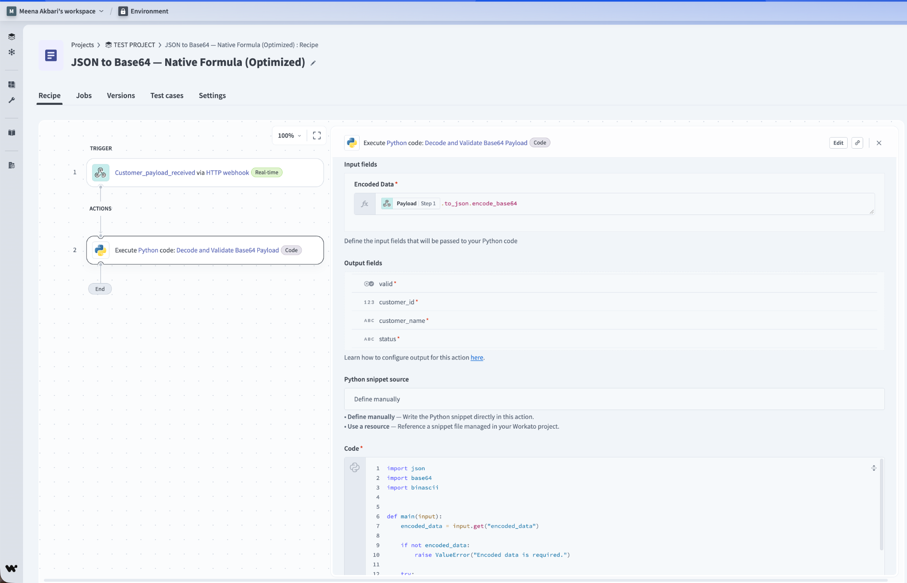
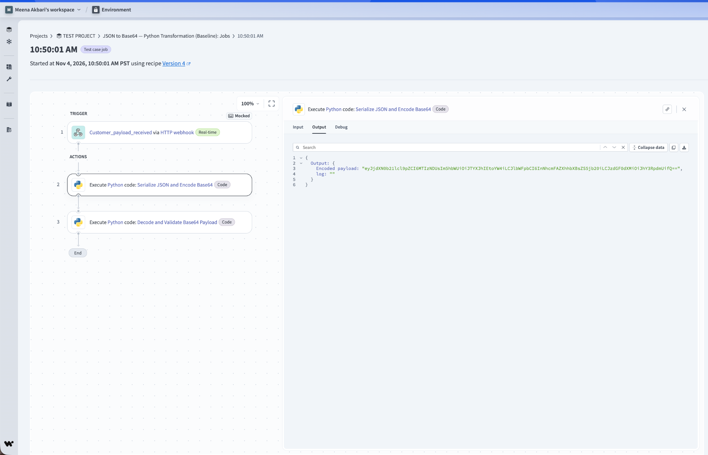
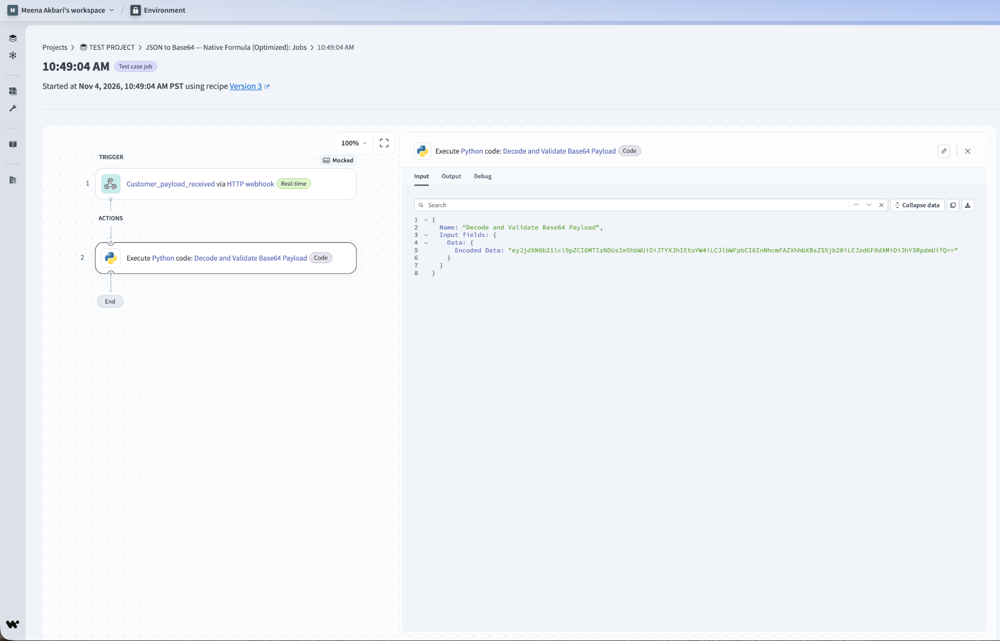

# Case Study 02 — Eliminating a Python Action with a Workato Formula

**Author:** Mina Akbari  
**Platform:** Workato  
**Technologies:** Python, JSON, Base64, Workato Formulas  
**Focus:** Recipe Optimization · Code Reduction · Maintainability

## Overview

This case study demonstrates how a simple JSON-to-Base64 transformation can be performed using Workato's native formula capabilities instead of a dedicated Python action.

The original workflow used two Python actions: one to encode a JSON payload and another to decode and validate it.

I optimized the recipe by replacing the Python encoder with a Workato formula directly in the existing decoder's input mapping.

### Key Result

**50% reduction in configured Python actions — from 2 to 1.**

The optimized design eliminates an unnecessary code step while preserving the existing decoder and validation logic.

## The Problem

The original Workato recipe received a customer webhook event and used a dedicated Python action to:

1. Serialize the customer payload into JSON.
2. Encode the JSON string into Base64.
3. Pass the encoded result to another Python action.
4. Decode and validate the customer data.

Although the workflow worked, the encoding operation was simple enough to be handled using Workato's built-in formulas.

A separate Python action introduced additional code and configuration that were not necessary for this transformation.

## The Solution

I removed the dedicated Python encoder and moved the serialization and encoding operation into the existing decoder action's input mapping.

### Baseline Workflow

```text
Customer Webhook
       |
       v
Python: Serialize JSON and Encode Base64
       |
       v
Python: Decode and Validate Base64 Payload
       |
       v
Validated Customer Data
```

**Python actions: 2**

### Optimized Workflow

```text
Customer Webhook
       |
       v
Workato Native Formula
(.to_json.encode_base64)
       |
       v
Python: Decode and Validate Base64 Payload
       |
       v
Validated Customer Data
```

**Python actions: 1**

The formula is applied within the existing Python action's input field, so it does not require a separate Workato action.

## Workato Formula

Select the webhook's **Payload** object datapill in the decoder's encoded-data input field and apply:

```ruby
.to_json.encode_base64
```

Conceptually, the complete expression is:

```ruby
Payload.to_json.encode_base64
```

This performs both transformations:

- `to_json` — Converts the webhook payload object into a JSON string.
- `encode_base64` — Encodes the JSON string into Base64.

The encoded result is passed directly to the existing Python decoder.

The optimized recipe uses the same decoder implementation as the baseline.

## Example Webhook Payload

**Event:** `customer_payload_received`

```json
{
  "payload": {
    "customer_id": 1001,
    "name": "Sara Johnson",
    "email": "sara@example.com",
    "status": "active"
  }
}
```

The `payload` object is the value used for encoding, rather than the entire event envelope.

The example contains synthetic customer information.

## Results

| Measurement | Baseline | Optimized |
|---|---:|---:|
| Python actions | **2** | **1** |
| Python actions eliminated | — | **1** |
| Python action reduction | — | **50%** |
| Encoding implementation | Python | Native Workato formula |
| Encoded Base64 values | Matching | Matching |
| Decoder implementation | Python | Same Python decoder |

### Key Achievements

**50% fewer Python actions**

Removed the dedicated encoding action while retaining the decoding and validation logic.

**Simplified recipe architecture**

Reduced the number of code steps and moved a straightforward data transformation into Workato's native formula capabilities.

**Matching encoded output**

The observed Workato execution screenshots show matching Base64 strings from the baseline Python encoder and optimized native formula.

**Improved maintainability**

Eliminated unnecessary Python encoding logic from the optimized workflow, making the transformation easier to inspect directly in the Workato recipe.

The 50% improvement measures configured Python actions. Overall Workato task consumption for this case has not been separately measured.

## Workato Recipe Exports

Both workflow definitions are available for technical comparison.

| Recipe | Description |
|---|---|
| [Baseline Recipe](recipes/baseline.recipe.json) | Original workflow with separate Python encoder and decoder actions |
| [Optimized Recipe](recipes/optimized.recipe.json) | Optimized workflow using native Workato encoding and the existing Python decoder |

These exports are provided as reference implementations. Workato connections, trigger configuration, and environment-specific settings may need to be configured before use.

## Python Source Code

| File | Purpose |
|---|---|
| [baseline_encoder.py](baseline_encoder.py) | Original Python JSON-to-Base64 encoder |
| [decoder.py](decoder.py) | Shared Python decoder and validation logic |

The baseline encoder validates the customer payload and produces an encoded string.

The decoder accepts the Base64-encoded input, decodes it, and validates the resulting customer data.

In the optimized design, `baseline_encoder.py` is no longer required as a Workato action.

## Screenshot Evidence

### Baseline — Two Python Actions

The original recipe uses one Python action for encoding and another for decoding and validation.



### Optimized — Native Workato Formula

The optimized recipe removes the Python encoder and performs the transformation directly in the decoder's input mapping.



### Encoding Validation

**Baseline — Python Encoder Output**



**Optimized — Native Formula Result**



The screenshots show matching Base64 values.

The baseline screenshot captures the encoder output, while the optimized screenshot captures the formula-generated decoder input. They do not independently establish full decoder-output equivalence.

## Engineering Considerations

### When to Use Native Formulas

Workato formulas are useful for straightforward operations such as:

- JSON serialization.
- String transformations.
- Base64 encoding.
- Date formatting.
- Basic data mapping.

### When to Use Python

Python remains valuable for:

- Complex business rules.
- Advanced data validation.
- Custom algorithms.
- Multi-step processing.
- Specialized error handling.

## Project Structure

```text
02-native-formula/
├── README.md
├── baseline_encoder.py
├── decoder.py
├── recipes/
│   ├── baseline.recipe.json
│   └── optimized.recipe.json
└── screenshots/
    ├── 01-python-baseline.png
    ├── 02-native-formula-optimized.png
    ├── 03-python-encoding-result.png
    └── 04-native-encoding-input.png
```

## Key Takeaway

**Reduced configured Python actions by 50% by replacing an unnecessary JSON-to-Base64 encoding step with a native Workato formula.**

This demonstrates an important Workato optimization principle:

**Use platform-native functionality for simple transformations and reserve custom code for operations that genuinely require it.**

---

**Developed and documented by Mina Akbari.**
