# Workato Recipe Optimization — Task Efficiency & Maintainability

**Author:** Mina Akbari  
**Stack:** Workato, Python, HTTP, REST APIs, JSON, Base64  
**Scope:** Two independent before/after case studies using public or synthetic data.

This portfolio project examines **when to consolidate actions with code** and **when to remove unnecessary code in favor of Workato-native formulas**. It preserves correctness and documents the operational tradeoffs instead of assuming fewer steps are always better.

## Case studies

| Case study | Baseline | Optimized | Observed evidence |
|---|---|---|---|
| [01 — API consolidation](01-api-consolidation/) | Five HTTP actions with separate monitors and logs | Single Python action performing five read-only calls | Successful Workato runs: **5 vs 1 tasks** |
| [02 — Native formula](02-native-formula/) | Python encode action → Python decoder | Workato `to_json.encode_base64` → same decoder | Matching Base64 strings; 2 vs 1 Python actions configured |

## Case Study 01 — API Integration: HTTP vs Python

**Public test service:** [JSONPlaceholder](https://jsonplaceholder.typicode.com/). The workflow gets a user, their posts, comments for a sample post, their todos, and their albums. It uses five external GET requests in both variants.

### Observed Workato job results (November 4, 2026)

| Measurement | Multi-step HTTP | Consolidated Python |
|---|---:|---:|
| Job status | Successful | Successful |
| Tasks used | **5** | **1** |
| Job duration | **910 ms** | **897 ms** |
| Tasks reduced | — | **4 per job (80%)** |

These numbers are taken from **one observed successful job of each design**. They establish a task-count difference in that sample, **not** a statistically significant performance difference or guaranteed financial savings. Python still makes five external API requests; internal retries can increase HTTP attempts. Actual pricing and task metering depend on plan and contract.

The optimized output reported `success=true`, `name_matches=true`, `completed_operations=5`, `error_count=0`, with 10 posts, 5 comments, 20 todos, and 10 albums. The baseline screenshot shows a successful job and a true name condition; **a detailed endpoint-by-endpoint output equivalence check has not yet been documented**.

### Design tradeoffs

- **Benefits:** Fewer Workato task-consuming actions, simpler high-level recipe view, centralized request handling.
- **Costs:** More code to own; step-level observability moves into Python; retry/error behavior requires explicit testing.
- **Important:** Python returns structured `success=false` errors for request failures. Without an outer Workato IF/raise action, the **Workato job can still appear successful**. See [Case Study 01 notes](01-api-consolidation/README.md).

### Workato screenshots — API consolidation

**Baseline: five HTTP actions and error-handling branches**

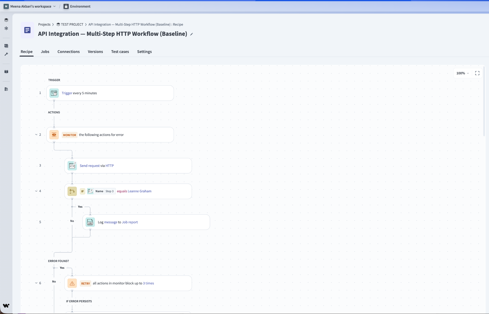
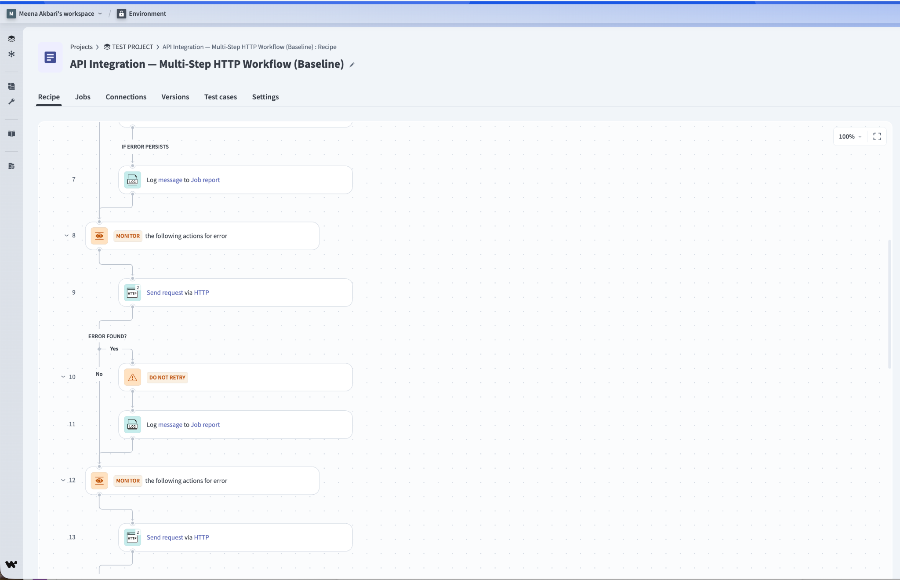
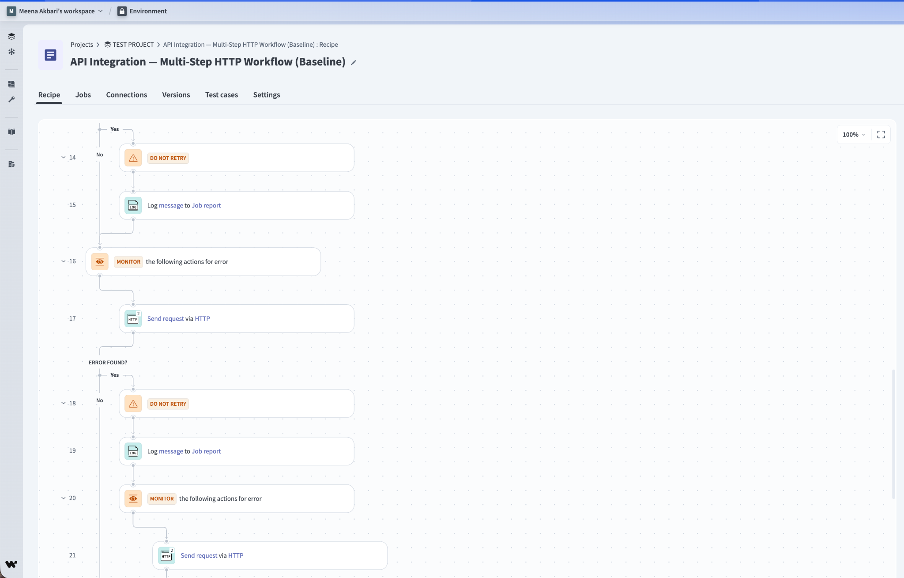
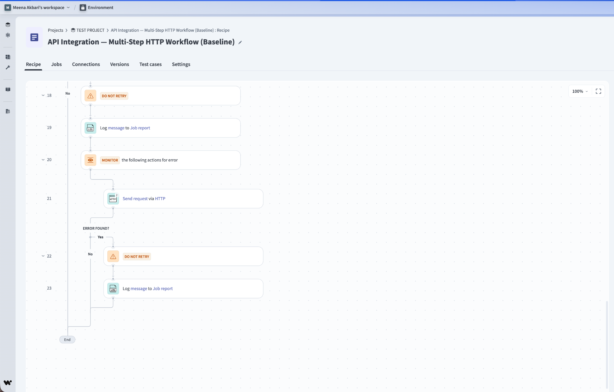

**Optimized: consolidated Python action**

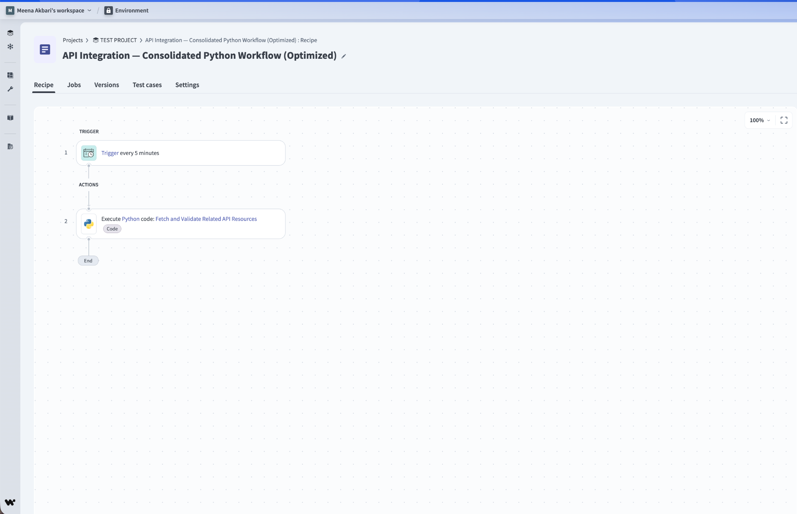

**Live Workato job evidence (November 4, 2026)**

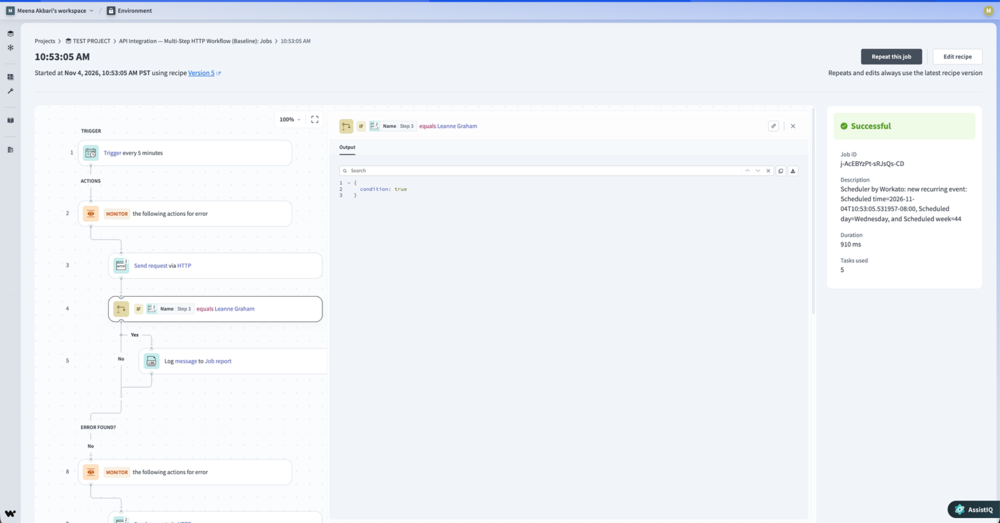
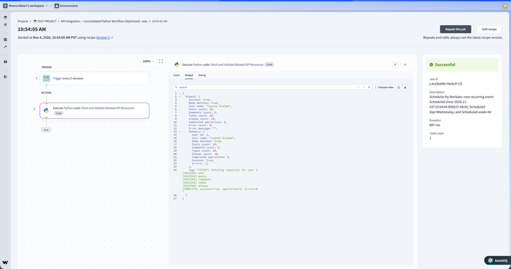


## Case Study 02 — JSON-to-Base64: Python vs Native Formula

Both versions start with the **same customer webhook payload**. The baseline serializes and Base64-encodes JSON with one Python action and passes the result to a second Python action that decodes and validates it. The optimized version removes the encoder action and maps the webhook `Payload` object to the existing decoder input with the Workato formula:

```ruby
Payload.to_json.encode_base64
```

`Payload` refers to the actual webhook object datapill; it is not typed as a literal string.

**Observed:** The Base64 strings shown in user-supplied Workato execution screenshots matched. Full decoder-output equivalence and Workato task counts for this case still need to be recorded; **2 vs 1 refers to configured Python actions, not a verified billed-task difference**.

### Tradeoffs

- Use a formula for straightforward transformations in an *already-existing* action input.
- Use a dedicated Python action when genuinely needed for complex normalization or validation.
- Base64 is an encoding, **not encryption**; do not use it to protect secrets.
- Cross-language JSON serialization may differ in key ordering/whitespace. Compare **decoded JSON structures** for functional equivalence; require byte-identical Base64 only if downstream integration needs it.

### Workato screenshots — native formula

**Baseline: separate Python encoder and decoder**

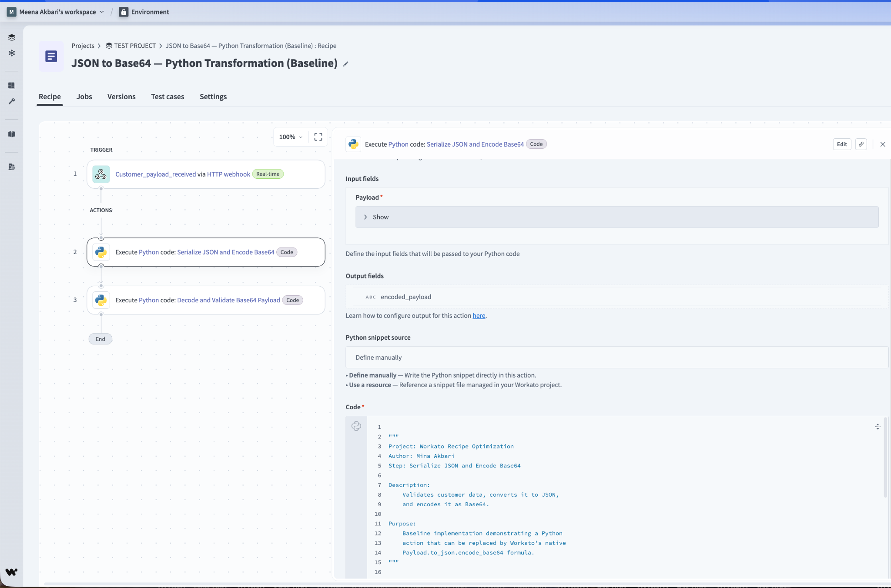

**Optimized: encoding with a native Workato formula**

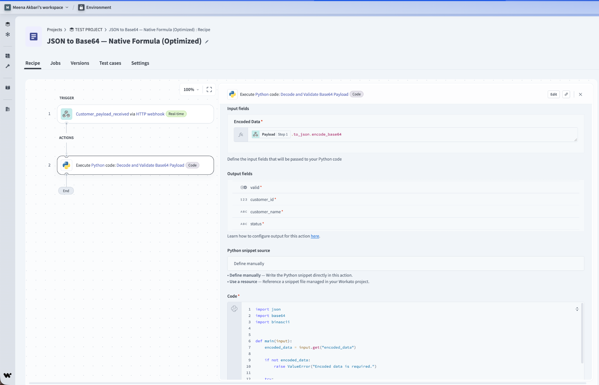

**Encoding evidence:** The baseline Python encoded output and the optimized decoder's formula-generated Base64 input show matching strings. The second screenshot shows an **input**, not the decoder's final output.

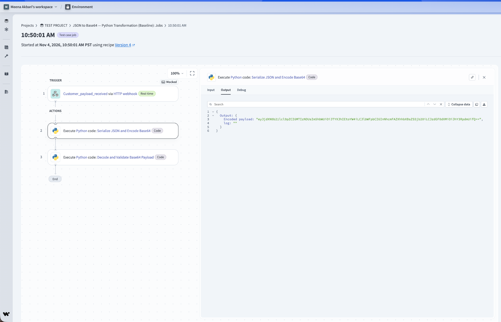
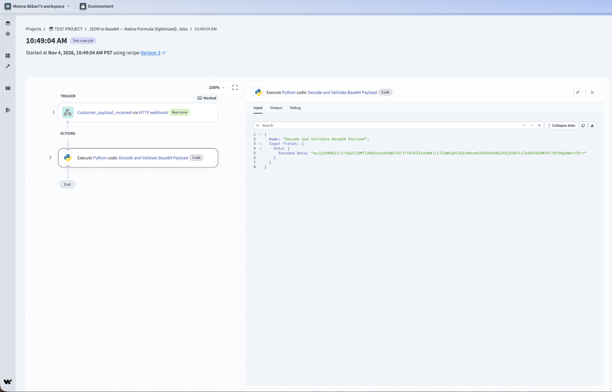


## Reproduce the code-level tests

The included tests do not need Workato credentials or network access:

```bash
python3 -m unittest discover -s tests -v
```

The live Workato job screenshots document the UI and job evidence; this local test suite exercises Python logic with fake HTTP responses and synthetic payloads.

## Files

- [`01-api-consolidation/optimized.py`](01-api-consolidation/optimized.py) — consolidated read-only public API implementation
- [`02-native-formula/baseline_encoder.py`](02-native-formula/baseline_encoder.py) — baseline Python encoder
- [`02-native-formula/decoder.py`](02-native-formula/decoder.py) — shared decoder/validator
- [`docs/WORKATO_SETUP.md`](docs/WORKATO_SETUP.md) — input/output schema, triggers, field mappings
- [`docs/BENCHMARKS.md`](docs/BENCHMARKS.md) — observations and measurement methodology
- [`docs/SCREENSHOT_GUIDE.md`](docs/SCREENSHOT_GUIDE.md) — screenshot filenames, upload and Markdown instructions
- [`tests/`](tests/) — isolated unit tests

## Security & provenance

Independently developed demonstration using a public read-only API and fictional customer records. **No employer code, access tokens, private Workato exports, or customer data** should be committed. Screenshots must be reviewed for credentials and tenant-specific information before upload.

## Limitations

This is an independently built portfolio example; not a production deployment. Baseline recipe designs are documented in screenshots rather than distributable Workato recipe exports, and the optimized scripts require the corresponding Workato fields and settings. Workato's Python runtime and plan limits may vary. For future benchmarking, capture identical inputs, successful endpoint outputs, retries, and task usage over multiple runs.
