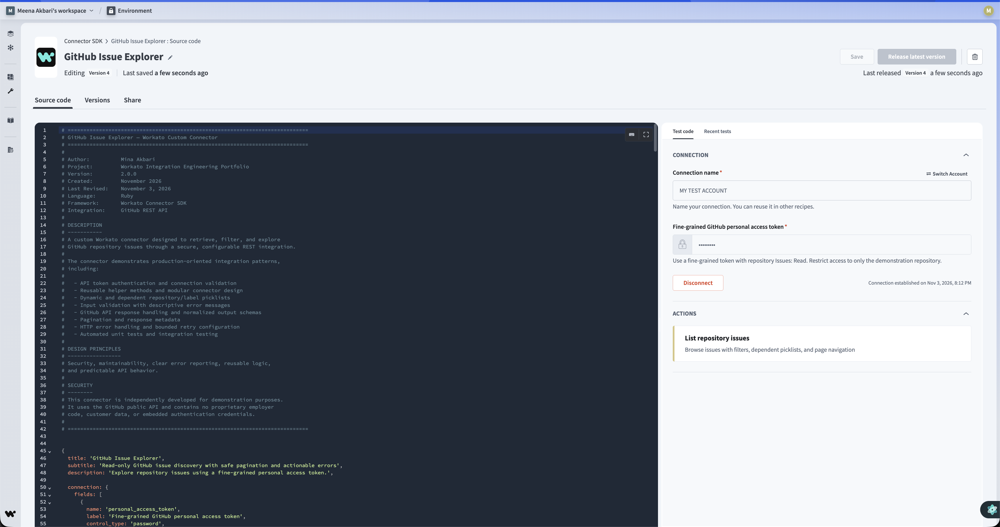
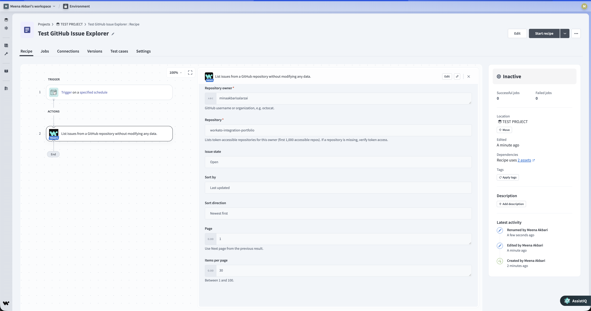
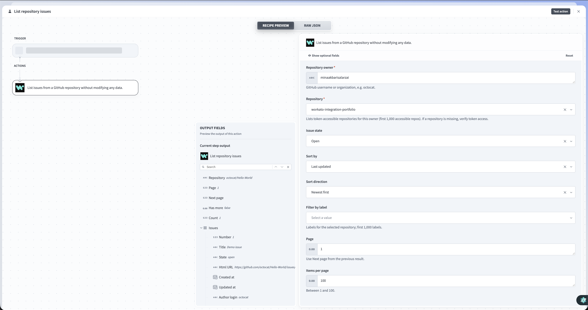
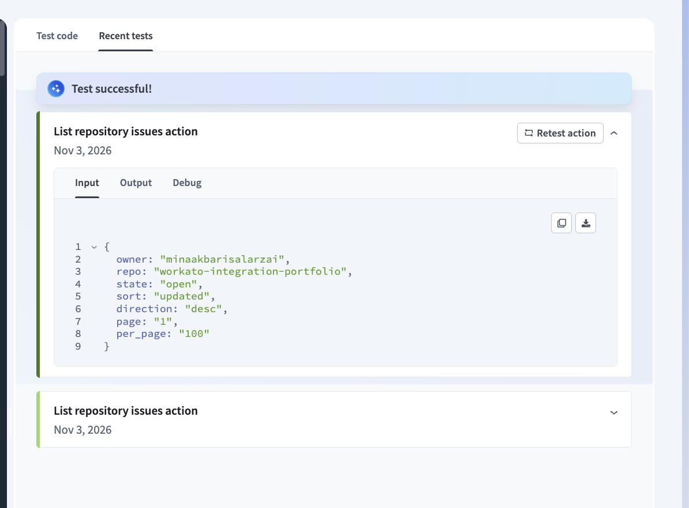
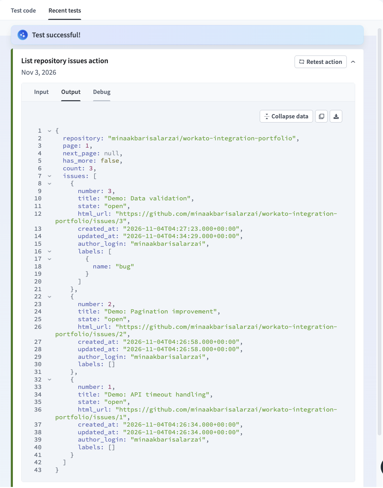
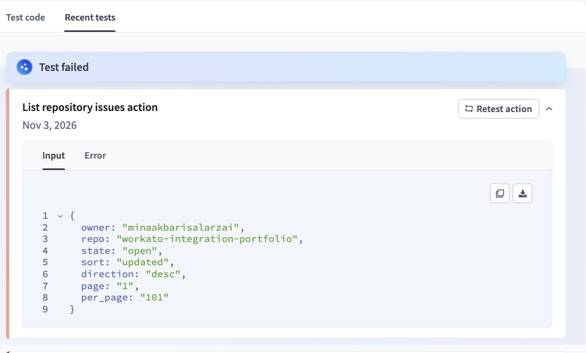
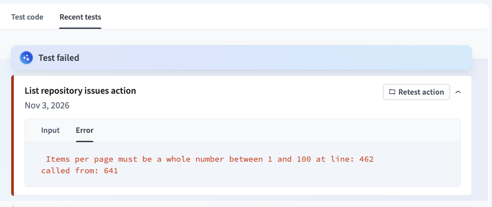

# GitHub Issue Explorer — Workato Custom Connector

**A Workato Connector SDK project demonstrating Ruby-based API integrations, secure authentication, dynamic picklists, reusable methods, pagination, error handling, and automated testing.**

**Author:** Mina Akbari  
**Language:** Ruby  
**Framework:** Workato Connector SDK  
**API:** GitHub REST API  
**Version:** 2.0.0  
**Last Updated:** November 2026  
**Project Type:** Independent Integration Engineering Portfolio

---

## Overview

GitHub Issue Explorer is a custom connector developed using the **Workato Connector SDK and Ruby**.

The connector integrates with the GitHub REST API and provides a configurable, read-only action for retrieving and filtering repository issues.

The project demonstrates how to design an integration that is secure, maintainable, extensible, and resilient to common API failures.

Rather than implementing numerous simple actions, this project focuses on building **one comprehensive action** that demonstrates several important features of the Workato Connector SDK.

### Key Capabilities

- Secure API authentication using fine-grained GitHub personal access tokens
- Connection validation through the GitHub REST API
- Reusable Ruby methods for common integration operations
- Static and dynamic picklists
- Dependent repository and label selection
- Configurable issue filtering and sorting
- Pagination with next-page detection
- Input validation and descriptive error messages
- Structured API response mapping
- HTTP error handling and retry configuration
- Automated Ruby tests with synthetic API responses

The connector is read-only and does not create, modify, or delete GitHub issues.

---

## Architecture

The integration follows a straightforward design:

```text
              Workato Recipe
                    |
                    v
          GitHub Issue Explorer
          Custom Ruby Connector
                    |
          +---------+---------+
          |                   |
          v                   v
    Authentication      Input Validation
          |                   |
          +---------+---------+
                    |
                    v
             GitHub REST API
                    |
                    v
             HTTP Response
                    |
          +---------+---------+
          |                   |
          v                   v
    Error Handling      Data Normalization
                              |
                              v
                      Structured Output
                              |
                              v
                       Workato Recipe
```

### Integration Flow

1. A recipe executes the custom connector's **List repository issues** action.
2. The connector validates the supplied inputs.
3. Authentication is applied using a configured GitHub access token.
4. The connector sends an HTTP request to the GitHub REST API.
5. Response status codes are evaluated, and supported errors are converted into descriptive messages.
6. Successful responses are normalized into structured output fields.
7. Pagination metadata is returned for subsequent requests.
8. Downstream Workato actions can process the retrieved issues.

---

## Engineering Features

| Feature | Implementation |
|---|---|
| Authentication | Bearer token authentication using a fine-grained GitHub personal access token |
| Connection testing | Authenticated GitHub `/user` endpoint |
| Custom action | List repository issues |
| Reusable methods | Validation, error formatting, response normalization, pagination |
| Static picklists | Issue state, sorting, sort direction |
| Dynamic picklists | Repository and label selection |
| Dependent fields | Repository options depend on owner; label options depend on owner and repository |
| Pagination | GitHub Link header parsing with `next_page` and `has_more` |
| Error handling | Custom messages for HTTP 401, 403, 404, 422, 429, and server errors |
| Retry configuration | Bounded retries for selected transient server failures |
| Output schema | Structured issue objects with nested label information |
| Input validation | Repository identifiers, page number, and page size |
| Automated testing | Ruby tests using synthetic response data |

### Design Principles

The connector was designed around five priorities:

**1. Security:** Authentication credentials are supplied through Workato connection fields rather than embedded in source code.

**2. Maintainability:** Reusable Ruby methods centralize common functionality and reduce duplication.

**3. Reliability:** Input validation, error handling, and retry configuration improve the connector's behavior during failures.

**4. Usability:** Dynamic picklists and descriptive errors help recipe developers configure and troubleshoot integrations.

**5. Testability:** Core behavior can be evaluated using automated tests without depending entirely on live GitHub API calls.

---

## Live Workato Demonstration

The connector has been exercised against the GitHub REST API in a Workato development environment using a personal demonstration repository and fictional GitHub issues.

The following screenshots document connector development, action configuration, successful API responses, and validation scenarios.

### 1. Custom Connector Implementation

The connector is implemented in Ruby using the Workato Connector SDK.

It includes connection configuration, reusable methods, picklists, object definitions, and a custom action.



### 2. Workato Recipe Integration

The custom connector can be selected as an action within a Workato recipe.

This demonstrates how the connector is exposed to recipe builders and configured for use in an automation workflow.



### 3. Action Configuration and Dynamic Fields

The **List repository issues** action supports configurable repository ownership, repository selection, issue state, sorting, label filtering, and pagination.

The connector uses picklists to improve the configuration experience.



### 4. Successful GitHub API Response

During live testing, the connector successfully retrieved three issues from the demonstration repository.

The returned response included issue numbers, titles, states, URLs, timestamps, authors, and labels.

**Test input — Valid configuration (`per_page = 100`)**



**Test output — Successfully retrieved GitHub issues**



### 5. Custom Input Validation

The connector implements explicit validation rules to reject unsupported input values and provide readable error messages.

This example demonstrates the validation of the maximum allowed page size.

**Test input — Invalid configuration (`per_page = 101`)**



**Test output — Custom validation error**




---

## Live Testing Results

The following scenarios were observed during development and testing of the connector. The core functionality was exercised in Workato; certain enhanced V2 features require additional live verification.

| Test Scenario | Observed Result |
|---|---|
| GitHub authentication | Successful |
| Retrieve repository issues | Successfully returned 3 issues |
| Parse structured issue output | Successful |
| Pagination — first page | Returned `next_page: 2` and `has_more: true` |
| Pagination — final page | Returned `next_page: null` and `has_more: false` |
| Label filtering | Returned the issue matching the `bug` label |
| Custom input validation | Rejected `per_page = 101` |
| GitHub HTTP 422 response | Returned a custom API error message |

### Pagination Test

Pagination was tested using `per_page = 1` against three demonstration issues.

**First page:**

```json
{
  "page": 1,
  "next_page": 2,
  "has_more": true,
  "count": 1
}
```

**Final page:**

```json
{
  "page": 3,
  "next_page": null,
  "has_more": false,
  "count": 1
}
```

These results demonstrate that the connector can expose navigation metadata based on GitHub's pagination response.

### Label Filtering Test

A `bug` label was applied to one demonstration issue.

The connector was then executed using the `bug` label filter, returning only the matching issue.

This verified the label-filtering behavior and nested label data in the response.

### Verification Limitations

The connector was revised after several successful live tests. Therefore, results from the earlier implementation should not be interpreted as comprehensive verification of every V2 change.

Additional live verification is recommended for large repository picklists, large label collections, permission failures, retry behavior, and rate limits.

---

## Automated Testing

The V2 connector includes an offline Ruby test suite.

**Local test results:**

- 19 tests passing
- 59 assertions passing
- Ruby syntax validation passing

The tests cover representative connector behavior, including validation, response normalization, pagination, and error-handling logic.

### Running the Tests

Install Ruby, navigate to this project directory, and execute:

```bash
ruby -c connector.rb
ruby spec/connector_test.rb
```

These tests provide regression coverage using synthetic responses and a lightweight test adapter.

They complement, rather than replace, testing inside the Workato SDK runtime.

Additional test procedures are documented in [TEST_PLAN.md](docs/TEST_PLAN.md).

---

## Error Handling

Providing descriptive errors is an important part of developing reliable API integrations.

The connector includes response handling for common GitHub API failures.

| HTTP Status | Handling |
|---|---|
| 401 — Unauthorized | Explain that authentication failed and the access token should be checked |
| 403 — Forbidden | Provide permission or rate-limit guidance |
| 404 — Not Found | Suggest verifying the repository identifier and token visibility |
| 422 — Validation Failed | Display a more descriptive validation error |
| 429 — Too Many Requests | Identify API rate limiting |
| 500–504 — Server Errors | Provide failure context and configure bounded retries for supported transient responses |

### Input Validation

The connector also validates input values before making API requests.

Examples include:

- Missing repository owner
- Invalid repository identifier
- Invalid page number
- Unsupported page size
- Invalid sorting options
- Unsupported issue-state values

This helps prevent unnecessary API requests and improves troubleshooting for recipe developers.

---

## Pagination Design

The connector retrieves one API page per action execution.

The response includes:

| Field | Description |
|---|---|
| `repository` | Selected GitHub repository |
| `page` | Current page number |
| `next_page` | Next available page number or null |
| `has_more` | Indicates whether another page is available |
| `count` | Number of issue objects returned after normalization |
| `issues` | Structured list of GitHub issues |

GitHub's repository issues endpoint can also return pull requests.

The connector excludes pull requests during normalization.

Because this filtering occurs after the API response, `count` may be smaller than `per_page`.

For reliable pagination, consumers should use `has_more` and `next_page` rather than assuming a page with fewer results means the end of the dataset.

---

## Dynamic Picklists

The connector demonstrates both static and dynamic picklists.

### Static Picklists

Static options are provided for:

- Issue state: Open, Closed, All
- Sorting: Created, Updated, Comments
- Sort direction: Ascending, Descending

### Dynamic Picklists

Dynamic picklists retrieve options from GitHub.

**Repository selection:** Available repository options are retrieved using an authenticated GitHub API request and filtered by the selected owner.

**Label selection:** Available labels are retrieved based on the selected repository.

The V2 implementation also includes bounded pagination for larger option collections.

### Known Limitations

- Repository and label discovery is bounded to avoid unlimited API requests.
- The dropdowns may not list every option in exceptionally large accounts or repositories.
- Private repository visibility depends on token permissions.
- Enhanced V2 picklist behavior requires further live verification.

---

## Authentication and Security

The connector uses fine-grained GitHub personal access tokens.

For a demonstration repository, the recommended configuration is:

| Setting | Value |
|---|---|
| Authentication | Fine-grained personal access token |
| Repository access | Selected demonstration repository |
| Issues permission | Read-only |
| Metadata permission | Read-only |

The token is entered through Workato's connection configuration.

**Security practices:**

- Never hardcode access tokens.
- Never commit credentials to version control.
- Grant only required repository permissions.
- Prefer read-only permissions when write access is unnecessary.
- Avoid publishing sensitive API responses.
- Use fictional records for public demonstrations.

This repository contains independently developed example code and synthetic test data. It does not contain proprietary employer integrations, internal business logic, customer information, or authentication credentials.

---

## Installation and Setup

### Prerequisites

- Access to a Workato workspace with Connector SDK capabilities
- A GitHub account
- A fine-grained GitHub personal access token
- A repository containing sample GitHub issues

### Installation

1. Open Workato's Connector SDK.
2. Create a custom connector named **GitHub Issue Explorer**.
3. Copy the source code from [connector.rb](connector.rb).
4. Save the connector and resolve any SDK validation errors.
5. Create a connection using a fine-grained GitHub personal access token.
6. Test the GitHub connection.
7. Create or open a Workato recipe.
8. Add the **List repository issues** action.
9. Select the repository and desired filters.
10. Execute the action and inspect its output.

For test scenarios and expected results, see [TEST_PLAN.md](docs/TEST_PLAN.md).

---

## Project Structure

```text
03-custom-connector/
├── connector.rb
├── README.md
├── LICENSE
├── docs/
│   ├── DESIGN.md
│   └── TEST_PLAN.md
├── fixtures/
│   └── issues_page.json
├── spec/
│   └── connector_test.rb
└── screenshots/
    ├── 01-connector-sdk.png
    ├── 02-recipe-configuration.png
    ├── 03-action-fields.png
    ├── 04-successful-api-response.png
    ├── 05-input-validation-error.png
    ├── 06-validation-test-input.png
    └── 07-successful-test-input.png
```

---

## Engineering Decisions

Several decisions were made to keep this connector focused and maintainable.

**One action with comprehensive functionality:** Instead of building numerous minimal actions, the connector demonstrates a single API operation with substantial supporting functionality.

**Reusable methods:** Common operations are separated into reusable methods to improve readability and reduce duplication.

**API-aware error handling:** Errors are translated into messages that help recipe developers diagnose authentication, permission, validation, and server failures.

**Bounded pagination:** Dynamic option retrieval and issue pagination are designed to avoid uncontrolled API requests.

**Structured output:** API responses are normalized into predictable fields that downstream recipes can consume.

**Testing and documentation:** The project includes automated tests, sample responses, a design document, a verification plan, and screenshots.

For additional implementation details, see [DESIGN.md](docs/DESIGN.md).

---

## Future Improvements

Potential extensions include:

- Official Workato SDK runtime test coverage
- More extensive retry and rate-limit testing
- Broader private-repository verification
- Additional GitHub integration actions
- Automated continuous integration testing
- A complete demonstration recipe consuming paginated results
- More comprehensive coverage of API edge cases

These are possible extensions, not implemented features.

---

## References

- [Workato Connector SDK Reference](https://docs.workato.com/en/developing-connectors/sdk/sdk-reference.html)
- [Workato SDK Picklists](https://docs.workato.com/en/developing-connectors/sdk/sdk-reference/picklists.html)
- [Workato SDK Error Handling](https://docs.workato.com/developing-connectors/sdk/guides/error-handling.html)
- [GitHub REST API — Repository Issues](https://docs.github.com/en/rest/issues/issues#list-repository-issues)

---

## About This Project

This project is part of my independent [Workato Integration Engineering Portfolio](https://github.com/minaakbarisalarzai/workato-integration-portfolio).

It demonstrates my approach to API integration development, automation design, reusable Ruby code, error handling, validation, and testing.

The project is intended as a technical work sample and educational demonstration. It is not affiliated with or endorsed by GitHub, Workato, or my employer.

**Developed by Mina Akbari.**
