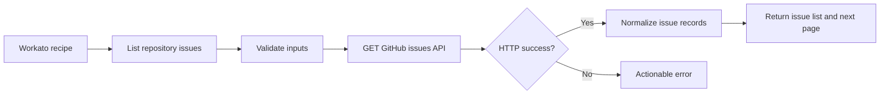

# Design decisions

## Data flow

## Why one action?

A single, fully featured read-only action is easier to review than several superficial CRUD actions. The repository shows the cross-cutting responsibilities that matter in real integrations: authentication, schema design, input validation, errors, retries, dropdowns, pagination, and testing.

## Security and authorization

- Credential fields are password-masked in Workato.
- All requests go to a fixed `https://api.github.com` base URI.
- Owner/repo path components are validated before interpolation.
- All network operations are GET; no accidental modification of GitHub issues.
- Use a least-privilege fine-grained token, restrict it to a demo repository, and rotate it if exposed.
- Do not add raw headers or token values to logs and error messages.

## Scope and honest limitations

- The action returns **one API page**. It does not silently fetch every page.
- Dynamic picklists read at most ten pages of 100 items (1,000 total), with additional calls for large accounts.
- Repository picklist uses authenticated `/user/repos` and filters by selected owner; private repos are included only if the token can access them.
- No OAuth2 handshake, triggers, bulk/streaming, or automatic stateful sync are implemented.
- The 403 handler checks rate-limit indicators; not all permission and throttling errors can be distinguished reliably.
- The previous version was verified in Workato for basic retrieval, pagination, filtering and local validation; this revised SDK implementation needs a new live test.

## Growth path

After verifying the basic connector: improve secondary rate-limit handling; add test recordings in the Workato SDK CLI; add cursor-style pagination in a companion recipe; document backoff and request budgets.
