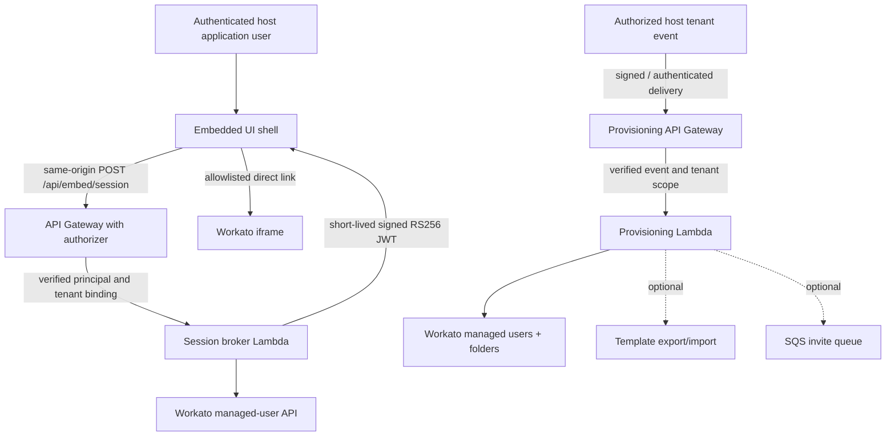

# Embedded Integration Studio — Workato Embedded Reference Implementation

**Architecture showcase · AWS Lambda · Workato Embedded API · JWT/RS256 · provisioning · role-aware access · JavaScript/Python integration engineering**

> **Portfolio status:** Independently reorganized and security-hardened **reference implementation**, derived from the workflow demonstrated in Mina Akbari's January 2025 master's capstone. **Offline tests included; cloud deployment and current Workato API compatibility are not verified.** Not a production deployment or the original LoanPro source tree.

**[▶ Watch the original project walkthrough on YouTube](https://www.youtube.com/watch?v=VWJzLgZdENw)**

## Why this project matters

Embedding an automation platform involves much more than adding an iframe. The host application needs a trusted identity boundary, short-lived embed sessions, tenant provisioning, workspace initialization, collaborator invitations, and repeatable error handling. This repository demonstrates how those responsibilities fit together, with a **fictional host application** rather than confidential employer code.

### Demonstrated capabilities

| Area | Portfolio implementation |
|---|---|
| Embedded interface | Responsive, accessible vanilla JavaScript shell with allowlisted navigation |
| JWT session broker | Node.js 20+ serverless handler, RS256 signing, short expiration, trusted authorizer context |
| Tenant discovery | Server-side Workato managed-user lookup; never trusts a client-supplied tenant ID |
| Provisioning | Python 3.11+ webhook handler, schema validation, managed-user creation, workspace folders |
| Templates | Optional export/import workflow behind an explicit feature flag |
| Invitations | Optional SQS enqueue with scoped worker contract |
| API integration | Bounded retries on transient failures; configurable timeouts and endpoints |
| Verification | Node native test runner + Python unittest with mocks; no cloud credentials needed |

## Architecture



**Trust boundary:** API Gateway / the host application's authorizer must authenticate the requester and supply `principalId` and `tenantId` through trusted authorizer context. The broker **does not** accept user-supplied tenant IDs. The webhook endpoint **must** enforce request authentication/signature verification before Lambda; deployment without these controls is unsafe.

## Quick start: offline tests

Requires Python 3.11+ and Node.js 20+; **no packages to install** for tests.

```bash
cd projects/04-embedded-integration
node --test services/embed-session/test/*.test.mjs web/*.test.mjs
PYTHONPATH=services/provisioning python3 -m unittest discover -s services/provisioning/tests -v
python3 -m compileall -q services/provisioning
```

The frontend can be previewed with any static HTTP server (for example `python3 -m http.server 8000 -d web`). Without a compatible authenticated `/api/embed/session` backend, the interface will show an authentication/setup error rather than rendering a live Workato session.

### CI template

[`docs/CI_EXAMPLE.yml`](docs/CI_EXAMPLE.yml) is a GitHub Actions example for the **portfolio repository root**. Copy it to `.github/workflows/embedded-integration-tests.yml` at the repository root if you want automated checks; keeping it here avoids claiming a nested workflow will run automatically.

## Code tour

- [`services/embed-session/`](services/embed-session/) — short-lived embed JWT generation and principal-bound tenant resolution.
- [`web/`](web/) — accessible shell; allowlisted routes; exact-origin `postMessage` validation.
- [`services/provisioning/`](services/provisioning/) — Workato API client, tenant provisioning orchestration, optional folder templates and SQS invitation contract.
- [`docs/ARCHITECTURE.md`](docs/ARCHITECTURE.md) — trust boundaries and sequence descriptions.
- [`docs/SECURITY.md`](docs/SECURITY.md) — threat model, deployment safeguards, and exposed credential response.
- [`docs/TEST_PLAN.md`](docs/TEST_PLAN.md) — offline verification and remaining integration tests.
- [`docs/ORIGINAL_PROJECT.md`](docs/ORIGINAL_PROJECT.md) — provenance, original capstone scope, and how this sample differs.

## Setup and deployment prerequisites

1. **Obtain publication authorization** for any employer-linked source/screenshots/video before including it publicly. This repository deliberately does **not** bundle the original raw source, keys, tokens, tenant IDs, or production screenshots.
2. Configure credentials in AWS Secrets Manager or equivalent. Do not put credentials, PEM material, account-specific IDs, or API keys in Git.
3. Deploy `services/embed-session/src/handler.mjs` behind a same-origin authenticated route. Its API Gateway authorizer must provide verified `principalId` and a **server-derived authorized** `tenantId`.
4. Store a current RS256 private key as a secret and have the Lambda runtime load it via the approved secret-injection mechanism. Configure `WORKATO_EMBED_VENDOR_ID`, `WORKATO_EMBED_ORIGIN`, and `WORKATO_API_TOKEN` through secrets/configuration.
5. Configure a protected webhook endpoint for the provisioning Lambda. Do **not** trust the JSON `tenant` fields without validating their authenticity and authorization at the gateway.
6. Review vendor-specific endpoint paths and response schemas against your current Workato Embedded tenant before enabling any managed-user, folder, invitation, export, or import operations.
7. Keep template copying and invitations **off** until corresponding dedicated live tests pass (`ENABLE_ASSET_COPY=false`, `ENABLE_INVITE_QUEUE=false`).

See [`docs/TEST_PLAN.md`](docs/TEST_PLAN.md) before performing any real cloud requests.

## Important implementation notes

- The broker issues an **embed token, not a host login token**. Authentication and tenant authorization must have been completed by the hosting app.
- The Workato iframe uses a short-lived JWT in the Workato direct-link URL per the historic embed mechanism; URLs can leak via logging/history. Set strict referrer and logging policies and confirm the current vendor-recommended embedding protocol.
- Source-folder copying is optional and is modeled as a bounded workflow. It is **not** guaranteed to be idempotent or atomic across multiple Workato API calls; consider a state machine for production.
- The supplied academic report describes features and outcomes but is not proof of production security, throughput, or complete test coverage.
- The project includes no usable keys or credentials. It will not perform real embedding until an authorized deployment is configured.

## Context and authorship

**Original capstone:** *Embedded Innovation Studio* (January 2025), Mina Akbari. The source material demonstrated iframe embedding, signed JWT generation, a LoanPro-to-Workato webhook integration, managed-user provisioning, folder templates, and collaborator workflow orchestration. The linked video is the author's original demonstration. This repository is a **new explanatory reference implementation**, not a claim of having deployed these refactored files to LoanPro.

**Independence and confidentiality:** All example data, endpoints and resources are fictional or generic. No proprietary employer code, customer data, credential values, or original private keys are included. This project is not affiliated with or endorsed by LoanPro or Workato.

## License

See [LICENSE](LICENSE). Only publish this reconstructed sample if you are entitled to release it.
